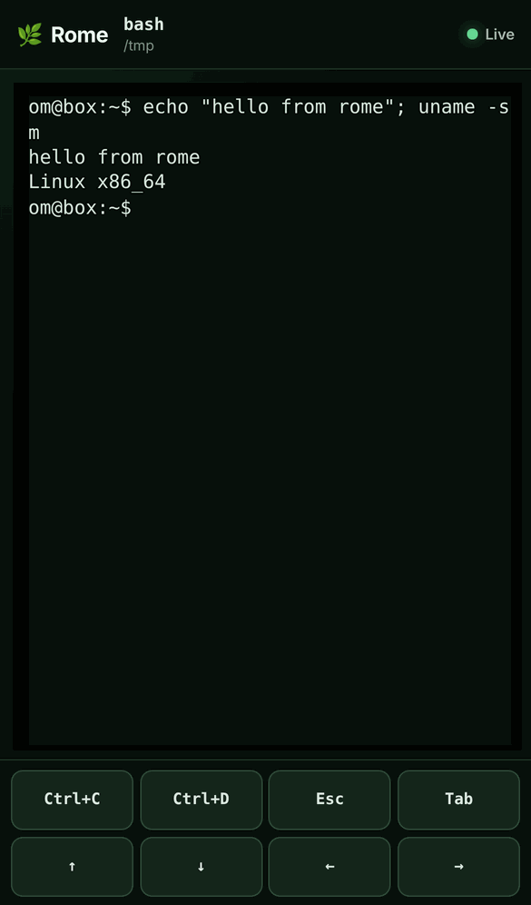
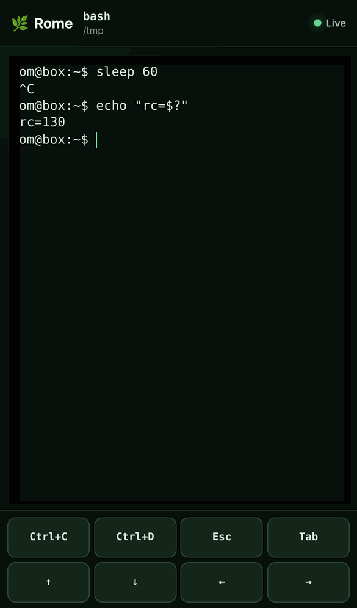

# Rome 🌿

**Take your terminal agents with you.** Rome runs any interactive CLI (`claude`,
`codex`, `bash`, anything) in a pseudo-terminal on your computer and lets you
watch and drive that same session from your phone's browser.

```console
$ rome claude
$ rome codex
$ rome <anything>
```

Long-running terminal agents tend to stop and wait for input the moment you
walk away. Rome keeps the session on your machine and gives your phone a
live, authenticated view of it, with one-tap Ctrl+C, Esc, Tab, and arrow keys,
so you can answer a prompt or interrupt a run without going back to your desk.

> [!WARNING]
> **Trusted LAN only.** Rome's phone connection is plain HTTP/WebSocket on your
> local network. It is **not encrypted** (no TLS, no end-to-end encryption).
> Only enable it on networks you trust, and **never expose it to the
> internet**. Anyone who sees the session URL or QR code can control the
> terminal until the session ends.

<p align="center">
  
  
</p>

## 30-second quickstart

```bash
brew install ompatel-24/tap/rome
ROME_LISTEN=127.0.0.1:7654 rome bash
```

Rome starts `bash` in your terminal and prints a QR code plus a URL like
`http://127.0.0.1:7654/s/<id>#token=<token>`. Open the URL in a browser to get
the same live session. To use your phone, replace `127.0.0.1` with your
computer's LAN address (for example `ROME_LISTEN=192.168.1.20:7654`) and scan the
QR code from a phone on the same trusted Wi-Fi.

Without `ROME_LISTEN`, Rome is just a local PTY wrapper and opens no network
port.

## Install

### Homebrew (macOS and Linux)

```bash
brew install ompatel-24/tap/rome
rome version   # rome 0.2.0
```

### Release archives

[GitHub releases](https://github.com/ompatel-24/rome/releases) contain archives
for macOS and Linux on amd64 and arm64, plus a SHA-256 checksum manifest. Each
archive contains only `rome`, `README.md`, and `LICENSE`. Download the archive
for your platform and the checksum file, verify, and install:

```bash
VERSION=0.2.0
PLATFORM=darwin_arm64   # or darwin_amd64, linux_amd64, linux_arm64
curl -LO https://github.com/ompatel-24/rome/releases/download/v${VERSION}/rome_${VERSION}_${PLATFORM}.tar.gz
curl -LO https://github.com/ompatel-24/rome/releases/download/v${VERSION}/rome_${VERSION}_checksums.txt
shasum -a 256 --ignore-missing -c rome_${VERSION}_checksums.txt
gh attestation verify rome_${VERSION}_${PLATFORM}.tar.gz --repo ompatel-24/rome
tar -xzf rome_${VERSION}_${PLATFORM}.tar.gz
install rome /usr/local/bin/rome
```

Checksums detect corruption; `gh attestation verify` checks GitHub provenance,
confirming the artifact was built by Rome's release workflow. On Linux,
`sha256sum --ignore-missing -c` works in place of `shasum -a 256`.

### Build from source

Rome requires Go 1.23 or newer. A plain `go build` embeds the committed browser
bundle and does not need Node.js:

```bash
git clone https://github.com/ompatel-24/rome.git
cd rome
go build -o dist/rome ./cmd/rome
./dist/rome bash
```

`make build` additionally needs a Vite-compatible Node.js/npm toolchain, because
it regenerates and verifies the committed browser bundle before building
`dist/rome`. Node.js is never needed to run Rome.

### Upgrading from Ivy 0.1.0

Rome was previously named Ivy. v0.2.0 is the first release published under the
Rome name; it renames the binary, Go module, environment variables, browser
storage keys, and WebSocket subprotocols together. Ivy installations do not
upgrade in place:

```bash
brew uninstall ivy
brew install ompatel-24/tap/rome
```

## Usage

```text
rome <command> [args...]
rome -- <command> [args...]
rome help
rome version
```

Rome executes the supplied argument vector directly. It does not invoke a shell,
parse agent output, or contain Claude-, Codex-, or other agent-specific code.
Use `--` to launch a command named `help` or `version`. When the child exits,
Rome restores your terminal and exits with the child's exit code.

Enable the phone/browser terminal by setting `ROME_LISTEN` to one concrete
address:

```bash
ROME_LISTEN=127.0.0.1:7654 rome bash        # loopback only
ROME_LISTEN=192.168.1.20:7654 rome claude   # your LAN address, trusted Wi-Fi only
```

Port `0` picks a free port. Wildcard hosts such as `0.0.0.0`, `[::]`, or an
empty host are refused before the child starts:

```console
$ ROME_LISTEN=0.0.0.0:7654 rome bash
rome: failed to start local transport: invalid ROME_LISTEN address "0.0.0.0:7654": wildcard hosts are not allowed
```

In an interactive terminal Rome prints a QR code and the session URL. Narrow,
dumb, and non-interactive terminals get only the one-line URL. The token lives
in the URL fragment, so it is not sent in HTTP requests; the browser moves it
into per-tab session storage and removes it from the address bar.

The QR code contains the same session-long token as the URL. Don't share
screenshots of it. Public and café Wi-Fi networks often isolate devices from
each other, so a phone may not be able to reach your computer there.

## Features

- **Works with any interactive CLI.** A real PTY, so colors, arrow keys,
  history, Tab completion, Ctrl+C, and Ctrl+D behave as usual.
- **Phone browser terminal (xterm.js), embedded in the binary.** No extra
  files or web server; the single `rome` executable serves it.
- **Shared live session.** Input from the phone and the local keyboard reach
  the same PTY, and both see the same output.
- **One-tap helper keys.** Ctrl+C, Ctrl+D, Esc, Tab, and arrow buttons.
- **QR pairing.** Scan instead of typing the URL.
- **Authenticated access.** Each session has its own random token; session
  metadata and WebSocket endpoints reject missing or wrong tokens, and
  cross-origin WebSockets are rejected. `GET /health` returns only
  `{"status":"ok"}`.
- **Reconnect with history.** The browser reconnects automatically after
  network loss and replays the newest 512 KiB of output.
- **Responsive resizing.** The PTY follows the phone's screen size.
- **Off by default.** No network listener unless `ROME_LISTEN` is set, and
  wildcard listeners are refused.
- **Verifiable releases.** Release archives ship with SHA-256 checksums and
  GitHub provenance attestations, plus a Homebrew formula.

## Environment variables

| Variable | Purpose |
| --- | --- |
| `ROME_LISTEN=<host:port>` | Enables the authenticated browser/phone transport on one concrete loopback or LAN address. Unset means no network listener. Wildcard hosts are rejected. |
| `ROME_WEB_DIR=<path>` | Development/testing only: serve the browser client from this directory instead of the embedded copy. Rome validates it and fails before launching the child if it isn't a valid production build. |
| `ROME_DEBUG=1` | Prints extra `rome: debug:` diagnostics to stderr for local terminal handling: falling back to a default size when the terminal size can't be read, failures restoring the terminal, PTY resize failures, and signal-forwarding failures. Any value except empty, `0`, `false`, or `no` enables it. |

## Platforms

macOS and Linux on amd64 and arm64. The browser client targets current stable
Safari and Chrome. Windows is not supported.

## Status and roadmap

Rome 0.2.0 is an early release. Not implemented yet:

- TLS/WSS for the phone connection
- End-to-end encryption
- A hosted relay for use outside your local network
- Apple code signing and additional package formats
- Windows support

## Session safety and limits

A Session ID is a random 128-bit routing identifier, not a credential. Network
clients authenticate with a separate per-Session token. Each subscriber has a
64-chunk queue; a client that can't keep up is disconnected instead of stalling
the PTY or other clients. Output history keeps the newest 512 KiB exactly as
received, so a replay may begin in the middle of an ANSI escape sequence or
UTF-8 character. See [docs/sessions.md](docs/sessions.md) for details.

## Development

```bash
make lint
make test
make build
make release-check
make release-snapshot
make dev ARGS=bash ROME_LISTEN=127.0.0.1:7654
```

- [docs/manual-testing.md](docs/manual-testing.md): compatibility matrix and verified results
- [docs/sessions.md](docs/sessions.md): the Session contract
- [docs/protocol.md](docs/protocol.md): the transport protocol
- [docs/mobile-client.md](docs/mobile-client.md): the browser client lifecycle
- [SECURITY.md](SECURITY.md): the security model
- [docs/releasing.md](docs/releasing.md): read before creating a version tag

## License

MIT. See [LICENSE](LICENSE).
